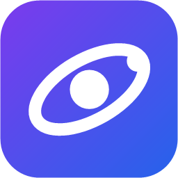

# QuantumHub



Хаб для плагинов под Windows. Сам по себе он не умеет ничего: это ядро, которое запускает
плагины, хранит их настройки, разрешает зависимости и даёт им общаться. Всё полезное
делают плагины, а окно на WinUI 3 служит админкой к этому ядру.

QuantumHub is licensed under PolyForm Noncommercial 1.0.0. It may include contributions from
external community contributors under the terms described in [CLA.md](CLA.md).

```
 Rider / VS Code / Discord / что угодно          QuantumHub.Gui (WinUI 3, трей)
        внешние плагины                                админка, тоже клиент
              │                                              │
              │   shared memory · named pipe · TCP (по желанию)
              └──────────────────────┬───────────────────────┘
                                     ▼
                       QuantumHub.Service  (фоновый процесс)
             роутер · загрузчик · зависимости · конфиги · состояние UI
                                     │
                       DLL-плагины внутри процесса хаба
```

---

## Установка

Скачай `QuantumHub-Setup-<версия>.exe` со [страницы релизов](https://github.com/QuantumDevTeam/QuantumHub/releases) и запусти. Больше ничего не нужно: .NET лежит внутри, права администратора не требуются.
Программа встанет в `%LOCALAPPDATA%\Programs\QuantumHub` со всеми плагинами и запустится сама.

- **Сервис** отдельно запускать не надо: его поднимает окно, а если он упал, поднимает снова.
- **Новый плагин** ставится двойным щелчком по файлу `.qhp`, перетаскиванием в окно или кнопкой на странице «Плагины».
- **Обновление** — тот же установщик поверх старой версии. Настройки и твои плагины останутся.
- **Удаление** — через «Установленные приложения» в Windows. Настройки останутся в `%APPDATA%\QuantumHub`.

Установщик не подписан, поэтому при первом запуске Windows может показать SmartScreen: нажми «Подробнее» и «Выполнить в любом случае».

---

## Быстрый старт для разработки

Нужны Windows 10 или 11 и .NET 10 SDK. Одна команда собирает всё сразу: хаб, GUI, плагины и их внешние части.

```bash
powershell -ExecutionPolicy Bypass -File scripts/publish.ps1
```

Результат лежит в `artifacts/QuantumHub`, эту папку можно положить куда угодно. Запусти GUI,
он сам поднимет хаб:

```bash
artifacts/QuantumHub/gui/QuantumHub.Gui.exe
```

GUI, собранный из IDE, тоже находит хаб сам и берёт его из `artifacts/QuantumHub`, вместе с плагинами. Если изменения
затронули хаб или плагины, запусти `publish.ps1` снова. Без этой папки поднимется голый хаб из `bin`, и список плагинов будет пуст.

Собрать установщик, с прогоном тестов:

```bash
powershell -ExecutionPolicy Bypass -File scripts/release.ps1
```

Результат лежит в `artifacts/release`: сам установщик, плагины отдельными файлами `.qhp` и контрольные суммы.

Теперь внешний плагин. В нём работают команды `uuid`, `text привет`, `specs`, `deps`, `bench`:

```bash
artifacts/QuantumHub/samples/QuantumHub.Sample.ExternalConsole.exe
```

Значение появится в GUI на странице **UUID Backend**. Тот же сценарий без .NET вообще:

```bash
python samples/python/hub_client.py
```

Тесты:

```bash
dotnet test tests/QuantumHub.Tests
```

---

## Документация

Сайт со всем сразу, включая описание каждого класса и метода:

```bash
powershell -ExecutionPolicy Bypass -File scripts/docs.ps1 -Serve
```

Те же статьи можно читать прямо здесь:

- [С чего начать](docs/index.md)
- [Что за проекты](docs/PROJECTS.md)
- [Архитектура и принятые решения](docs/ARCHITECTURE.md)
- [Путь одного сообщения через всю систему](docs/WALKTHROUGH.md)
- [Приёмы в коде](docs/TECHNIQUES.md)
- [Словарь](docs/GLOSSARY.md)
- [Как написать плагин](docs/PLUGINS.md)
- [Протокол: для клиентов на любом языке](docs/PROTOCOL.md)

Участие в проекте:

- [Contributing Guide](CONTRIBUTING.md)
- [Contributor License Agreement (CLA)](CLA.md)
- [Git & Workflow Policy](docs/GitPolicy.md)
- [Versioning Strategy](docs/Versioning.md)
- [Changelog](CHANGELOG.md)

---

## Что где

| Папка | Что это |
|---|---|
| `contracts/proto` | Всё, что идёт по проводу: конверт, API хаба, манифест, UI |
| `src/QuantumHub.Contracts` | То, что видит плагин: `IHubPlugin`, `IPluginContext`, `IHubBus` |
| `src/QuantumHub.ProtoMemProtocol` | Транспорты: кольца в shared memory, pipe, рукопожатие |
| `src/QuantumHub.Core` | Ядро: роутер, загрузка, зависимости, конфиги |
| `src/QuantumHub.Service` | Exe хаба |
| `src/QuantumHub.Client` | SDK для внешних плагинов на .NET |
| `src/QuantumHub.Gui` | Админка на WinUI 3 |
| `src/QuantumHub.Ui.Contracts` | Контракт нативного UI плагина |
| `src/QuantumHub.Setup` | Установщик и деинсталлятор |
| `plugins/` | Плагины: активность, звук, музыка, уведомления, VR, VRChat, характеристики |
| `companions/` | Внешние части плагинов: окна, которые хаб сам показать не может |
| `samples/` | Внешние плагины-примеры на C# и Python |
| `tests/` | Тесты |
| `scripts/` | Сборка программы, установщика и документации |
| `docs/` | Статьи и настройка сайта документации |

---

## Текущее состояние

Проект на ранней стадии.

* API нестабилен
* Архитектура продолжает меняться
* Ломающие изменения ожидаемы

---

## License

QuantumHub is licensed under the PolyForm Noncommercial License 1.0.0.

You may use, study, modify, and distribute QuantumHub for noncommercial purposes under the terms
of the license.

Commercial use of QuantumHub or derivative works is prohibited without explicit written
permission from the project owner.

Official license text:
https://polyformproject.org/licenses/noncommercial/1.0.0

See [LICENSE](LICENSE.md) for full terms and [THIRD-PARTY-NOTICES](THIRD-PARTY-NOTICES.md) for
the components QuantumHub is built on.

---

### Commercial Licensing

Future commercial licensing options may become available as QuantumHub approaches production
readiness.

If you are interested in commercial usage, integration, or partnership opportunities, please
contact QuantumDevTeam.
