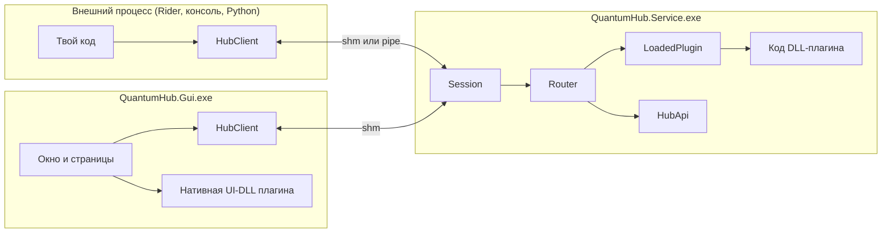
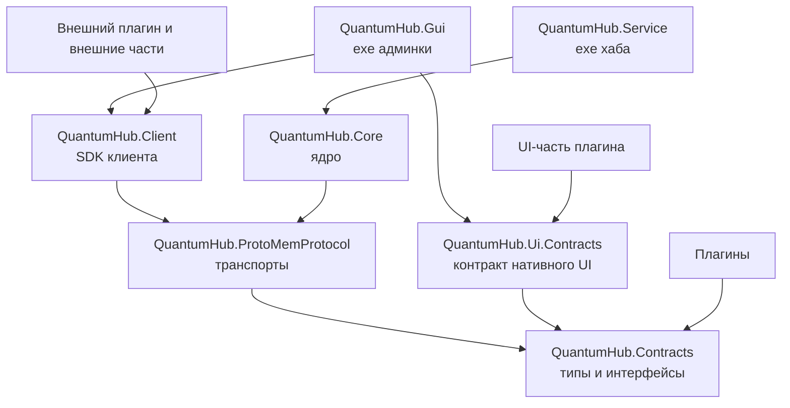
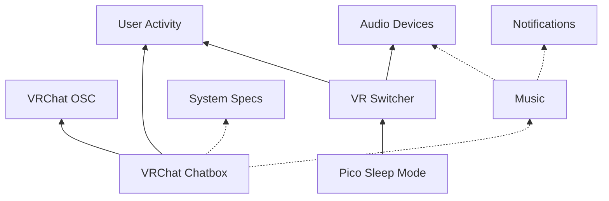

# Что за проекты

В решении 24 проекта. Выглядит много, но идея простая: **каждый процесс получает только то, что
ему нужно**. Хабу незачем знать про WinUI, GUI незачем уметь загружать плагины, а внешнему плагину
незачем тянуть всё ядро.

## Что работает во время выполнения

Сначала посмотрим на живую систему. Это три вида процессов:

Запомни главное: **GUI и внешний плагин для хаба одно и то же**, это клиенты с `HubClient`. Хаб
не отличает админку от плагина для Rider ничем, кроме поля `role`.

## Кто на кого ссылается

Стрелка значит «ссылается на». Заметь, что всё сходится к `Contracts`, а зависимостей по кругу нет.

Что отсюда следует:

- **Плагин ссылается только на `Contracts`.** Он не видит ядро и не может полезть в его внутренности.
  Поэтому ядро можно переписать, не сломав ни одного плагина.
- **`Core` не ссылается на `Client`, и наоборот.** Они встречаются только в протоколе.
- **`Service` — это почти пустой exe**, вся логика в `Core`. Поэтому тесты могут запустить настоящий хаб
  прямо у себя в процессе.
- **Только `Gui` и `Ui.Contracts` знают про WinUI.** Хаб остаётся лёгким.

## Проекты по порядку

### Основа

| Проект | Что это | Подробнее |
|---|---|---|
| `contracts/proto` | Описание всего, что идёт по проводу. Это не C#-проект, а исходники protobuf | [README](../contracts/README.md) |
| `QuantumHub.Contracts` | Классы из proto плюс интерфейсы плагина. Самая важная сборка: это публичный API | [README](../src/QuantumHub.Contracts/README.md) |
| `QuantumHub.ProtoMemProtocol` | Транспорты: кольца в памяти, pipe, кадры. Общий код хаба и клиента | [README](../src/QuantumHub.ProtoMemProtocol/README.md) |

### Хаб

| Проект | Что это | Подробнее |
|---|---|---|
| `QuantumHub.Core` | Всё ядро: роутер, загрузка плагинов, зависимости, конфиги, рукопожатие | [README](../src/QuantumHub.Core/README.md) |
| `QuantumHub.Service` | Exe: разбирает аргументы, следит за единственностью и запускает `Core` | [README](../src/QuantumHub.Service/README.md) |

### Клиенты

| Проект | Что это | Подробнее |
|---|---|---|
| `QuantumHub.Client` | SDK для внешних плагинов на .NET. Им же пользуется GUI | [README](../src/QuantumHub.Client/README.md) |
| `QuantumHub.Gui` | Админка на WinUI 3: окно, трей, страницы плагинов | [README](../src/QuantumHub.Gui/README.md) |
| `QuantumHub.Ui.Contracts` | Интерфейс нативной страницы. Отдельно, потому что зависит от WinUI | [README](../src/QuantumHub.Ui.Contracts/README.md) |
| `QuantumHub.Setup` | Установщик и деинсталлятор в одном exe | [README](../src/QuantumHub.Setup/README.md) |

### Плагины

Каждый плагин — отдельная часть. Напрямую друг на друга они не ссылаются, а общаются через хаб: один объявляет возможность,
другой вызывает её по имени. Поэтому любой можно заменить или убрать. Плагин может что-то делать, предоставлять API и
иметь настройки, но ничего из этого не обязан. Логика отделена от железа интерфейсами и проверяется тестами.

| Плагин | Что делает | Предоставляет | Нужно ему |
|---|---|---|---|
| [User Activity](../plugins/QuantumHub.Plugin.Activity/README.md) | Окно в фокусе, процессы, простой, запущен ли VR | `user.activity` | |
| [System Specs](../plugins/QuantumHub.Plugin.SystemSpecs/README.md) | Характеристики и загрузка компьютера | `system.specs`, `system.stats` | |
| [Audio Devices](../plugins/QuantumHub.Plugin.AudioDevices/README.md) | Устройства, приложения со звуком, громкость | `audio.devices` | |
| [Notifications](../plugins/QuantumHub.Plugin.Notifications/README.md) | Всплывающие окошки для всех | `ui.notifications` | |
| [Music](../plugins/QuantumHub.Plugin.Music/README.md) | Трек, уведомления, приглушение | `media.player` | `audio.devices`*, `ui.notifications`* |
| [VR Switcher](../plugins/QuantumHub.Plugin.VrSwitcher/README.md) | Переводит звук на гарнитуру, пресеты | `vr.session` | `audio.devices`, `user.activity` |
| [Pico Sleep Mode](../plugins/QuantumHub.Plugin.PicoAntiSleep/README.md) | Не даёт шлему заснуть | `vr.pico.sleep` | `vr.session` |
| [Discord](../plugins/QuantumHub.Plugin.Discord/README.md) | Клиент Discord без окон: мьют, канал, участники, пинг, Rich Presence | `discord.client` | |
| [SteamVR Dashboard](../plugins/QuantumHub.Plugin.VrDashboard/README.md) | Вкладка в меню SteamVR: звук, Discord, режим сна, чатбокс | | `user.activity`, `vr.session`*, `discord.client`*, `vr.pico.sleep`*, `vrchat.chatbox`* |
| [VRChat OSC](../plugins/QuantumHub.Plugin.VrChatOsc/README.md) | Связь с игрой: чат, аватар, трекеры, приём | `vrchat.osc` | |
| [VRChat Chatbox](../plugins/QuantumHub.Plugin.Chatbox/README.md) | Строки в чатбоксе, статус, мини-окно | `vrchat.chatbox` | `vrchat.osc`, `user.activity`, `media.player`*, `system.stats`* |
| [UUID Backend](../plugins/QuantumHub.Plugin.UuidBackend/README.md) | Пример: хабовая половина разделённого плагина | | |

Звёздочкой отмечены необязательные зависимости: без них плагин работает, просто умеет меньше.

Сплошная стрелка — обязательная зависимость, пунктирная — необязательная.

Нативная страница [User Activity UI](../plugins/QuantumHub.Plugin.Activity.Ui/README.md) показывает, как плагин рисует свой интерфейс на WinUI.

### Внешние части плагинов

Хаб — фоновый процесс без окон. Всё, что плагин хочет показать на экране, живёт в отдельном маленьком приложении, которое плагин
запускает сам. Оно подключается к хабу обычным клиентом и закрывается, если хаб пропал.

| Проект | Чья часть | Что это |
|---|---|---|
| [QuantumHub.Notifier](../companions/QuantumHub.Notifier/README.md) | Notifications | Всплывающие окошки |
| [QuantumHub.VrChatPanel](../companions/QuantumHub.VrChatPanel/README.md) | VRChat Chatbox | Мини-окно для статуса и сообщений |
| [QuantumHub.VrDashboard](../companions/QuantumHub.VrDashboard/README.md) | SteamVR Dashboard | Панель в меню SteamVR |

### Внешние плагины и проверка

| Проект | Что это | Подробнее |
|---|---|---|
| `QuantumHub.Sample.ExternalConsole` | Консольный внешний плагин на C#, он же замер скорости | [README](../samples/QuantumHub.Sample.ExternalConsole/README.md) |
| `samples/python` | Клиент на Python без зависимостей. Доказывает, что протокол не привязан к .NET | [README](../samples/python/README.md) |
| `QuantumHub.Tests` | Тесты, в том числе с настоящим хабом и настоящим IPC | [README](../tests/QuantumHub.Tests/README.md) |
| `scripts` | Сборка установки и генерация этого сайта | [README](../scripts/README.md) |

## Откуда взялись твои проекты

Твоё разделение на `Contracts` и `ProtoMemProtocol` оказалось правильным и осталось. Внутри поменялось всё,
но граница «контракты отдельно, реализация транспорта отдельно» — та самая, на которой всё держится.
Подробно о том, что и почему изменилось, рассказывает статья [Приёмы в коде](TECHNIQUES.md).
