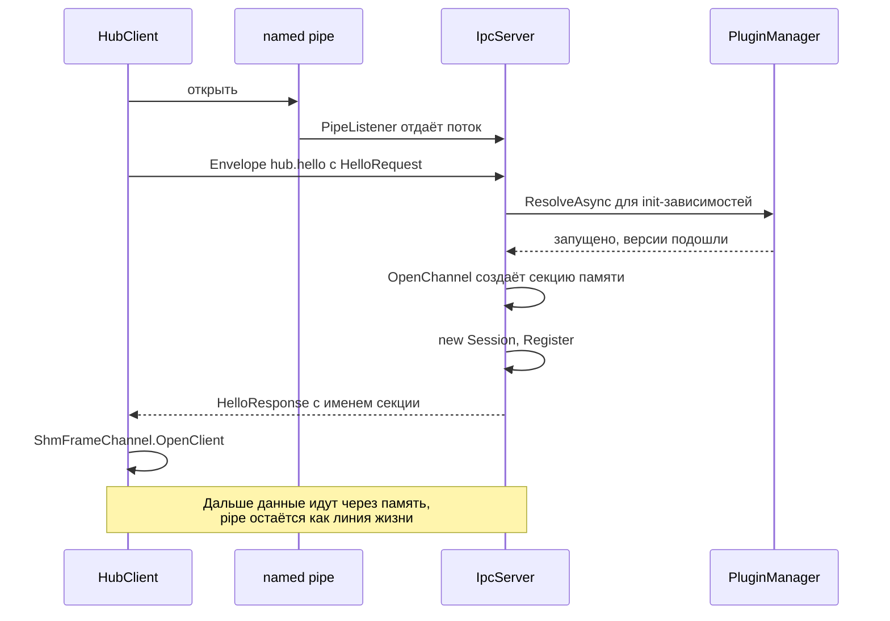
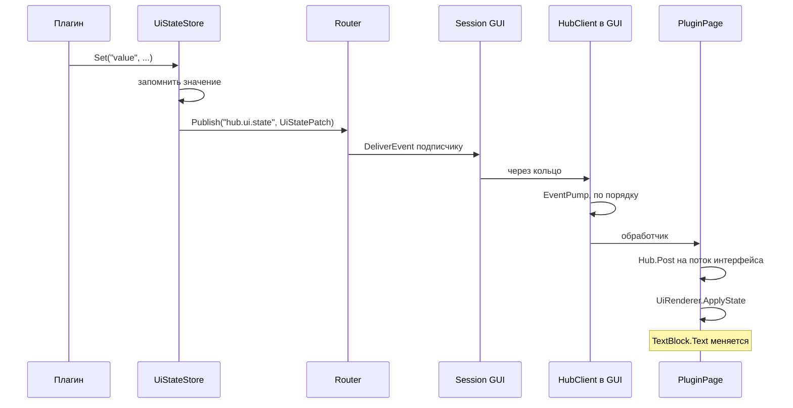

# Путь одного сообщения

Лучший способ понять систему — пройти через неё вместе с одним сообщением. Возьмём сценарий из
примера: внешняя программа присылает UUID, а он появляется в окне GUI.

```csharp
await client.CallAsync("qh.sample.uuid", "value.submit", HubPayload.Json(new { kind, value }));
```

Открой код рядом: все названия ниже — это настоящие классы и методы.

## Шаг 0. Подключение

Прежде чем вызывать что-то, клиент должен подключиться. Это рукопожатие.



Что здесь важно:

1. **`HubClient.EstablishAsync`** открывает pipe и шлёт `HelloRequest`: кто я, что умею, что мне нужно.
2. **`IpcServer.HandleConnectionAsync`** на стороне хаба читает его. Если обязательной зависимости нет,
   клиент получает отказ со списком того, чего не хватает, и у него вылетает `HubRejectedException`.
3. **`IpcServer.OpenChannel`** выбирает транспорт. Клиент умеет `shm`, значит создаётся
   `ShmFrameChannel.CreateServer`: секция памяти с двумя кольцами и четырьмя событиями.
4. Обе стороны получают по **`IFrameChannel`**. С этого момента никому не важно, что под ним.

Pipe не закрывается: он передан в канал как `lifeline`. Запомни это, вернёмся в шаге 7.

## Шаг 1. Отправка

`HubClient.CallAsync`:

```csharp
var request = Envelopes.Request(_options.ClientId, target, method, payload);
request.Id = Interlocked.Increment(ref _nextId);
var waiter = new TaskCompletionSource<Envelope>(TaskCreationOptions.RunContinuationsAsynchronously);
_pending[request.Id] = waiter;
await channel.SendEnvelopeAsync(request, token);
var response = await waiter.Task.WaitAsync(timeout ?? _options.CallTimeout, token);
```

Вот весь смысл RPC поверх потока сообщений. Запросы и ответы — это независимые сообщения, а связывает
их только `Id`. Мы кладём в словарь `_pending` «обещание» и ждём его. Когда придёт ответ с этим же id,
кто-то другой выполнит обещание. Благодаря этому одновременно могут идти тысячи вызовов.

`FrameCodec.SendEnvelopeAsync` сериализует конверт в буфер из пула, добавляет четыре байта длины и
передаёт в `ShmFrameChannel.SendAsync`.

## Шаг 2. Кольцо

`ShmRing.TryWrite`, здесь и живёт скорость:

```csharp
source[..first].CopyTo(new Span<byte>(_data + offset, first));   // копируем в общую память
Volatile.Write(ref *_tail, tail + count);                        // публикуем
Interlocked.MemoryBarrier();                                     // полный барьер
if (Volatile.Read(ref *_consumerSleeping) != 0) _dataReady.Set();
```

В обычном случае это копирование памяти и запись одного числа. Ни одного обращения к ядру Windows.
`_dataReady.Set()` вызывается, только если читатель действительно уснул.

## Шаг 3. Приём в хабе

В хабе на выделенном потоке крутится `ShmFrameChannel.ReadLoop`. Он читает заголовок и тело через
`ReadExact`, а тот, если данных нет, зовёт `ShmRing.WaitForData`: сначала ~50 мкс крутится на месте, а
потом засыпает. Именно это ожидание в цикле делает ответ таким быстрым, а сон даёт нулевую нагрузку в простое.

Прочитанный кадр уходит в `Session.OnFrame`:

```csharp
var envelope = FrameCodec.Decode(body);
envelope.Source = Id;   // личность берётся из соединения, а не из слов клиента
```

Заметь вторую строку: что бы клиент ни написал в `source`, хаб перезапишет его настоящим id.

Запрос может выполняться долго, а этот поток должен продолжать читать, поэтому работа уходит в пул
потоков: `Session.HandleRequestAsync`.

## Шаг 4. Роутер

`Router.RequestAsync` смотрит только на `Target`:

1. Ищет `qh.sample.uuid` в таблице `_endpoints`. Плагин запущен, поэтому он там есть.
2. Если бы его не было, `ActivateTarget` запустил бы плагин по требованию или разобрал адрес вида
   `cap:system.specs`.
3. Вызывает `endpoint.RequestAsync`. Для роутера это просто `IEndpoint`, им может быть плагин, клиент или
   сам хаб. Поэтому вызов из плагина в клиент работает точно так же.

Тело сообщения роутер не трогает. Он вообще не знает, что там JSON.

## Шаг 5. Плагин

`LoadedPlugin.RequestAsync` находит обработчик в словаре `_handlers` и вызывает код плагина. Этот обработчик
плагин зарегистрировал в своём `StartAsync`:

```csharp
context.Bus.Handle("value.submit", (request, _) =>
{
    var submit = request.Payload.AsJson<SubmitRequest>();
    return ValueTask.FromResult(HubPayload.Json(Store(submit.Kind, submit.Value, request.Source)));
});
```

Если здесь вылетит исключение, `LoadedPlugin` поймает его и вернёт ответ с ошибкой. Хаб не упадёт.

`UuidBackendPlugin.Store` делает три вещи, каждая запускает свою цепочку:

```csharp
config.Set("lastValue", value);                        // 1. сохранить
ui.Set("value", Display(...));                         // 2. обновить интерфейс
_context.Bus.PublishAsync("uuid.updated", ...);        // 3. сообщить подписчикам
```

## Шаг 6а. Ответ возвращается

`Envelopes.Response` собирает ответ, `Session.HandleRequestAsync` проставляет ему id запроса и отправляет
его обратно через второе кольцо. На стороне клиента `HubClient.OnFrame` видит `EnvelopeKind.Response`:

```csharp
if (_pending.TryRemove(envelope.Id, out var waiter)) waiter.TrySetResult(envelope);
```

То самое обещание из шага 1 выполнено, `await` в `CallAsync` продолжается. Весь круг занял около 6 мкс.

## Шаг 6б. Значение попадает на экран

Параллельно идёт `ui.Set("value", ...)`:



GUI подписан на `hub.ui.state` в `PluginPage.LoadAsync`. `UiRenderer` при построении страницы запомнил,
какой контрол привязан к какому ключу, и теперь просто вызывает нужный колбэк.

`UiStateStore` хранит последнее значение в хабе. Поэтому GUI, открытый через час, увидит его сразу, а
плагину не нужно ничего отправлять заново. И если GUI вообще закрыт, никто ничего не теряет: хаб
работает сам по себе.

## Шаг 6в. Значение попадает на диск

`ConfigStore.Set` меняет значение в памяти и сдвигает таймер на 250 мс. Если плагин пишет часто, диск
тронут только один раз, когда всё утихнет. `ConfigStore.Flush` пишет через временный файл, поэтому сбой в
середине записи не испортит настройки.

## Шаг 7. Смерть клиента

Что будет, если внешнюю программу убьют? В разделяемой памяти просто ничего не изменится, она об этом не
знает. Но помнишь pipe из шага 0?

1. Windows закрывает все хэндлы умершего процесса, в том числе его конец pipe.
2. `ShmFrameChannel.WatchLifelineAsync` в хабе всё это время висел на чтении, и оно завершается.
3. `SignalClosed` будит поток чтения и вызывает `Session.OnClosed`.
4. Сессия завершает все ждущие запросы ошибкой `Unavailable`, чтобы никто не висел вечно.
5. `IpcServer.OnSessionClosed` убирает её из таблиц, и в GUI пропадает строка на странице «Подключения».

На всё это уходит меньше 50 мс, и работает это при любой причине смерти, даже если процесс снят
через диспетчер задач.

## Ещё два маршрута

### Настройка из GUI

Пользователь нажал переключатель «Верхний регистр»:

1. `UiRenderer.RenderToggle` видит настоящее изменение и вызывает `Send`, в `bind` лежит `config:uppercase`.
2. Запрос `hub.ui.event` приходит в `HubApi.HandleUiEventAsync`.
3. Видя префикс `config:`, хаб сам пишет значение через `ConfigStore.Set`. **Код плагина для этого не нужен.**
4. `ConfigStore.Changed` срабатывает, и `LoadedPlugin.OnConfigChanged` сообщает плагину через
   `IPluginConfig.Changed`. Тот заново выставляет `value`, уже заглавными буквами.

### Запуск плагина по требованию

Клиент вызывает `cap:system.specs`, а плагин ещё не запущен:

1. `Router.RequestAsync` не находит адрес и зовёт `Hub.ActivateTargetAsync`.
2. `PluginManager.FindCapabilityProvider` находит поставщика через `DependencyResolver.Match`.
3. `EnsureStartedAsync` проверяет циклы, поднимает зависимости, а `LoadedPlugin.StartAsync` создаёт
   `PluginLoadContext`, загружает DLL и находит класс.
4. Запрос выполняется, будто плагин был запущен всегда.
