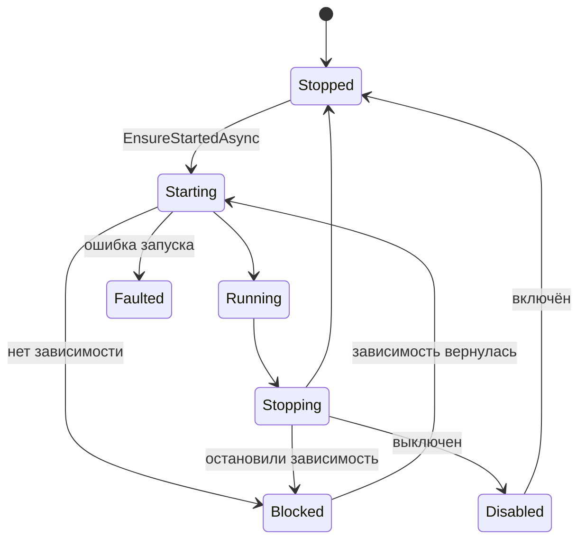

# QuantumHub.Core

Всё ядро хаба. Вынесено из exe в библиотеку, чтобы тесты могли запускать настоящий хаб.

| Файл | Что внутри |
|---|---|
| `Hub.cs` | Собирает все части вместе. **Начни отсюда** |
| `IpcServer.cs` | Приём клиентов и рукопожатие |
| `Session.cs` | Одно подключённое соединение |
| `HubApi.cs` | Методы `hub.*` |
| `Routing/Router.cs` | Доставка сообщений |
| `Routing/IEndpoint.cs` | Что угодно, кому можно адресовать сообщение |
| `Plugins/PluginManager.cs` | Жизненный цикл плагинов |
| `Plugins/LoadedPlugin.cs` | Запущенный плагин и его контекст |
| `Plugins/PluginLoadContext.cs` | Изоляция сборок плагина |
| `Plugins/PluginPackage.cs` | Поиск и установка на диске |
| `Plugins/ManifestReader.cs` | Манифесты, в том числе встроенные в DLL |
| `Plugins/DependencyResolver.cs` | Подбор поставщиков и поиск циклов |
| `Plugins/SemVersion.cs` | Версии и диапазоны |
| `Config/ConfigStore.cs` | Настройки в JSONC |
| `UiStateStore.cs` | Последнее состояние интерфейсов |
| `HubLog.cs` | Журнал |
| `HubPaths.cs` | Где что лежит |

## Как части связаны

`Router` — центр. На нём зарегистрированы `HubApi`, все `LoadedPlugin` и все `Session`, и для него они
одинаковы: это `IEndpoint`. Поэтому плагин может вызвать клиента, клиент плагина, и код при этом один.

Жизненный цикл плагина:

